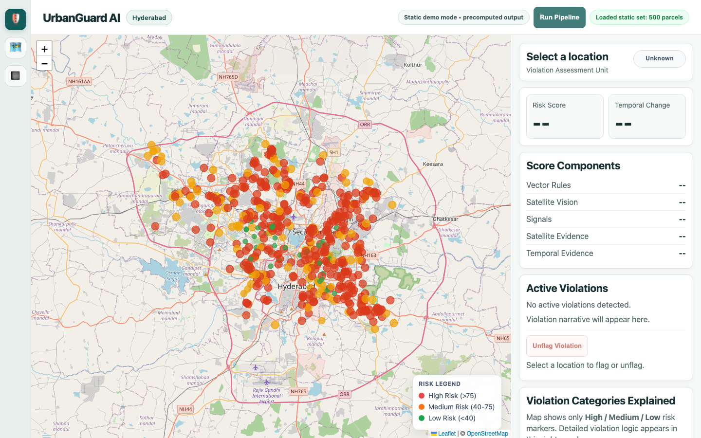

# UrbanGuard AI

UrbanGuard AI is an end-to-end Hyderabad-scale urban violation detection platform:

- Vector Compliance Engine (parcel, road, canal, lake, spillover, built-up ratio)
- Satellite Vision Engine (tile ingestion + segmentation inference + encroachment scoring)
- Temporal Change Engine (historical footprint delta + optional imagery differencing)
- ML Risk Fusion Engine (XGBoost/RandomForest/GradientBoosting + fallback)
- Explainable AI Engine (feature contributions, narratives, SHAP top factor)
- API + Interactive Dashboard

## Dashboard preview

The frontend includes a bundled 500-parcel preview dataset and can run in static mode without API credentials. Static hosting is read-only: running the pipeline and flagging records require API mode.

The current backend does not implement the `/auth/*` and violation flagging endpoints requested by the API-mode frontend. The bundled static preview works, but secure API-mode login and flagging remain pending because implementing authentication changes the security model.



Before and after captures at 375, 768, and 1440 px are in [docs/DESIGN-BRIEF.md](docs/DESIGN-BRIEF.md).

## Architecture

```
Raw GIS + Imagery
  -> CRS Standardization (EPSG:3857)
  -> Vector Features + Rule Triggers
  -> Satellite Tile Fetch + Segmentation
  -> Temporal Change Features
  -> ML Risk Fusion
  -> XAI Narratives / SHAP
  -> GeoJSON + Dashboard API
```

## Project Layout

```
backend/
  api.py
  cli.py
  config.py
  fusion_engine.py
  ml_model.py
  satellite_engine.py
  sentinel_hub.py
  temporal_engine.py
  vector_engine.py
  xai_engine.py
  data/
frontend/
  index.html
  map.js
  sidebar.js
  styles.css
models/
tests/
requirements.txt
.env.example
Dockerfile
```

## 1) Environment Setup

```bash
python3 -m venv venv
venv/bin/pip install -r requirements.txt
cp .env.example .env
```

## 2) Run Pipeline

```bash
venv/bin/python backend/fusion_engine.py
# or
venv/bin/python -m backend.cli run-pipeline --max-buildings 50000
```

Outputs:
- `backend/data/urban_guard_results.parquet`
- `backend/data/urban_guard_results.geojson`
- `backend/data/urban_guard_summary.json`

## 3) Run API + Dashboard

```bash
venv/bin/uvicorn backend.api:app --host 0.0.0.0 --port 8000 --reload
# or
venv/bin/python -m backend.cli serve --host 0.0.0.0 --port 8000 --reload
```

Open:
- Dashboard: [http://localhost:8000/dashboard](http://localhost:8000/dashboard)
- API docs: [http://localhost:8000/docs](http://localhost:8000/docs)

Key endpoints:
- `GET /health`
- `POST /pipeline/run?max_buildings=50000&async_run=true`
- `GET /pipeline/status`
- `GET /violations?limit=1000&offset=0`
- `GET /parcel/{parcel_id}`

## 4) Segmentation / Temporal Models

Place trained models in:
- `models/segmentation_model.pt`
- `models/temporal_model.pt`
- `models/risk_model.pkl`

Behavior:
- If Sentinel Hub credentials are configured, satellite engine calls Processing API (`sentinel-2-l2a` by default) with `maxCloudCoverage` + `mosaickingOrder`.
- If `segmentation_model.pt` exists and is loadable, imagery runs through torch segmentation inference.
- If segmentation is unavailable, imagery still runs through heuristic vision extraction.
- If remote imagery fails, engine falls back to vector-only satellite proxies.
- Temporal engine runs footprint-growth logic and can add imagery differencing from Sentinel Hub or configured XYZ templates.

## 5) Sentinel Hub Setup

Add your credentials to `.env`:

```bash
URBANGUARD_SENTINEL_CLIENT_ID=your-client-id
URBANGUARD_SENTINEL_CLIENT_SECRET=your-client-secret
URBANGUARD_SENTINEL_COLLECTION=sentinel-2-l2a
URBANGUARD_SENTINEL_MAX_CLOUD=20
URBANGUARD_SENTINEL_MOSAICKING_ORDER=leastCC
URBANGUARD_SENTINEL_USE_CATALOG=true
```

Notes:
- Supported collections: `sentinel-2-l1c`, `sentinel-2-l2a`
- `previewMode` is passed only for L1C requests
- Processing endpoint used: `https://services.sentinel-hub.com/api/v1/process`
- Catalog endpoint used: `https://services.sentinel-hub.com/api/v1/catalog/1.0.0/search`
- When catalog is enabled, engine selects least-cloud scenes first, then requests Processing API around those acquisition timestamps.

## 6) Production Notes

- Tile requests are cached in `backend/data/tile_cache` by default.
- Set `URBANGUARD_CORS_ORIGINS` to a comma-separated allowlist if the API is called from a separate frontend origin. Same-origin dashboard hosting does not need CORS.
- Control remote usage with `URBANGUARD_MAX_REMOTE_TILES`.
- Set `URBANGUARD_HISTORICAL_XYZ_TEMPLATE` for image-based temporal differencing.
- Use `async_run=true` on `/pipeline/run` for long jobs.
- If GIS source files are too large for GitHub, provide direct parquet URLs via:
  - `URBANGUARD_LAYER_BUILDINGS_URL`
  - `URBANGUARD_LAYER_ROADS_URL`
  - `URBANGUARD_LAYER_PARCELS_URL`
  - `URBANGUARD_LAYER_WATER_URL`
- Missing layers are downloaded once and cached in `URBANGUARD_LAYER_STORAGE_DIR` (default: `backend/data/layers`).
- Expected format for fallback URLs: GeoParquet with a valid `geometry` column (EPSG can be transformed in-engine).

## 7) Tests

```bash
venv/bin/pytest -q
```

GitHub Actions runs dependency, syntax, and test checks on pushes and pull requests. It disables remote imagery calls to keep CI deterministic and cost free.

## 8) Train Risk Model (Labeled Data)

If you have a labeled parcel dataset with `known_violation` (0/1):

```bash
venv/bin/python -m backend.cli train-risk \
  --input /path/to/labeled_features.parquet \
  --label known_violation \
  --model-type xgboost
```

## 9) Docker

```bash
docker build -t urbanguard-ai .
docker run -p 8000:8000 --env-file .env urbanguard-ai
```

## 10) Free static deployment (GitHub Pages)

The repository includes `.github/workflows/deploy-frontend-pages.yml`. It publishes the bundled static dashboard from `frontend/` when changes reach `main`; it does not host the Python API or run the data pipeline.

1. In GitHub, open **Settings → Pages** and set the source to **GitHub Actions**.
2. Merge the reviewed branch into `main` after approval. The existing workflow publishes the dashboard.
3. Open the deployment URL shown in the Pages workflow run.

Cloudflare Pages is a static-host backup: create a project from this GitHub repository, set the build command to none, and set the output directory to `frontend`. It has the same static-mode limitations.

## 11) Optional API deployment (Render)

This repository also includes a `render.yaml` Docker blueprint. The free web service sleeps after 15 minutes of inactivity, has ephemeral storage, and is resource constrained; the city-scale pipeline may exceed those limits. Sentinel Hub and fallback layer URLs are optional and should only be set if you use those integrations.

For the static dashboard no environment variables or database are required. `Live URL: not deployed yet`.
